# ANÁLISE EXPLORATÓRIA SAML-D

**Projeto:** FraudRadar
**Dataset:** Synthetic Anti-Money Laundering Transaction Dataset (SAML-D)
**Finalidade:** documentar as análises exploratórias realizadas antes do treinamento dos modelos de identificação de transações suspeitas.

---

O **SAML-D (Synthetic Anti-Money Laundering Dataset)** é um conjunto de dados sintético desenvolvido para monitoramento de transações financeiras e identificação de possíveis comportamentos relacionados à lavagem de dinheiro.

Sua finalidade no projeto é fornecer exemplos de transações classificadas como normais e suspeitas, permitindo treinar modelos de Machine Learning para identificar padrões associados à lavagem de dinheiro.

# 1. Objetivo

A **análise exploratória de dados (Exploratory Data Analysis - EDA)** busca compreender a estrutura, a qualidade, a distribuição e as relações presentes no conjunto de dados antes da etapa de modelagem.

Na **FraudRadar**, a EDA foi utilizada para:

* Conhecer as colunas e os tipos de dados disponíveis;
* Verificar a qualidade dos dados: valores ausentes, duplicados e valores monetários inválidos;
* Compreender a distribuição da variável alvo `Is_laundering`;
* Investigar valores das transações, modalidades de pagamento, moedas e localizações bancárias;
* Analisar a recorrência, a concentração e a diversidade de relacionamentos entre contas;
* Explorar padrões por hora, dia da semana, dia e mês;
* Comparar transações entre localizações bancárias iguais e diferentes;
* Estudar a relação entre `Laundering_type` e a variável-alvo;
* Produzir gráficos que facilitam a interpretação dos padrões encontrados.

A EDA também orienta **decisões posteriores de pré-processamento e Machine Learning**. Ela não comprova que uma transação específica seja criminosa, seus resultados descrevem os rótulos e padrões disponíveis no dataset.

# 2. Características

| Característica                                | Resultado               |
| ---------------------------------------------- | ----------------------- |
| Total de transações                          | 9,504,852               |
| Quantidade de colunas                          | 12                      |
| Transações normais (`Is_laundering = 0`)   | 9,949,979               |
| Transações positivas (`Is_laundering = 1`) | 9,873                   |
| Percentual positivo                            | 0,103873%               |
| Período                                       | 07/10/2022 - 23/08/2023 |
| Valores ausentes                               | 0                       |
| Registros duplicados                           | 0                       |

## 1.1 - Colunas

| Coluna                 | O que representa                         | Importância                        |
| :--------------------- | :--------------------------------------- | :---------------------------------- |
| Time                   | Horário da transação                  | Identificar padrões de horários   |
| Date                   | Data da transação                      | Identificar padrões temporais      |
| Sender_account         | Conta remetente                          | Comportamento de envio              |
| Receiver_account       | Conta destinatária                      | Comportamento de envio              |
| Amount                 | Valor da transação                     | Identificar padrões monetários    |
| Payment_currency       | Moeda do pagamento                       | Identificar moedas utilizadas       |
| Received_currency      | Moeda recebida                           | Analisar diferenças de moedas      |
| Sender_bank_location   | Localização bancária do remetente     | Identificar origem das operações  |
| Receiver_bank_location | Localização bancária do destinatário | Identificar destino das operações |
| Payment_type           | Tipo de pagamento                        | Identificar padrões por modalidade |
| Is_laundering          | Indicador de lavagem de dinheiro         | Variável-alvo                      |
| Laundering_type        | Tipo de comportamento identificado       | Caracterização dos comportamentos |

## 3 - Qualidade e Integridade dos Dados (*Data Quality Analysis*)

## 3.1 - Valores ausentes

Verificação utilizada:

```python
dataset.isna().sum().sort_values(ascending=False)
```

Nenhuma das doze colunas apresentou valores ausentes (`NaN`). Portanto, o notebook não precisou realizar imputação de valores ausentes nessa etapa.

## 3.2 - Registros duplicados

Verificação utilizada:

```python
dataset.duplicated().sum()
```

Nenhum registro apresentou valor duplicado.

## 3.3 - Valores monetários

| Verificação de `Amount` |        Resultado |
| --------------------------- | ---------------: |
| Mínimo                     |             3,73 |
| Máximo                     |    12.618.498,40 |
| Valores iguais a zero       |                0 |
| Valores negativos           |                0 |
| Soma infinita               | Não (`False`) |

Verificação utilizada para valores infinitos:

```python
np.isinf(dataset["Amount"].sum())
```

Verificação utilizada para encontrar o menor e maior valor:

```python
print(f"Maior valor: {dataset[coluna].max():.2f}")
print(f"Menor valor: {dataset[coluna].min():.2f}")
```

Os valores mínimo e máximo apresentados indicam uma **amplitude monetária elevada**. Os valores extremos devem ser investigados, mas não removidos, pois não comprovam automaticamente lavagem de dinheiro.

## 3.4 - Consistência dos identificadores e dos timestamps

| Verificação                                                       | Resultado observado |
| ------------------------------------------------------------------- | ------------------: |
| Valores de `Amount` não positivos                                |                   0 |
| Valores não finitos em `Amount`                                  |                   0 |
| IDs de remetente ou destinatário menores ou iguais a zero          |                   0 |
| Transferências em que remetente e destinatário são a mesma conta |                   0 |
| Timestamps ausentes ou inválidos após conversão                  |                   0 |
| Inversões na ordem cronológica do dataframe                       |                   0 |
| Valores distintos de `Is_laundering` além de 0 e 1               |              Nenhum |

Esses resultados indicam que, nas verificações realizadas, não foram encontrados problemas nesses campos. A checagem de ordem cronológica se refere à sequência atual das linhas no dataframe; não comprova, isoladamente, que qualquer divisão posterior de treino, validação e teste esteja livre de vazamento temporal.

# 4 - Rótulo da Variável-Alvo

A variável `Is_laundering` é o alvo binário utilizado no problema de classificação:

- `0`: transação não identificada como lavagem de dinheiro
- `1`: transação identificada como suspeita de lavagem de dinheiro

| Classe                              |          Quantidade |     Percentual |
| ----------------------------------- | ------------------: | -------------: |
| 0 — Não identificada como lavagem |           9.494.979 |     99,896127% |
| 1 — Identificada como lavagem      |               9.873 |      0,103873% |
| **Total**                     | **9.504.852** | **100%** |

# 5- Distribuição dos Valores

## 5.1 - Desbalanceamento de classes

O conjunto apresenta **desbalanceamento extremo**: a classe negativa representa 99,98961% dos registros, enquanto a classe positiva representa 0,1039%.

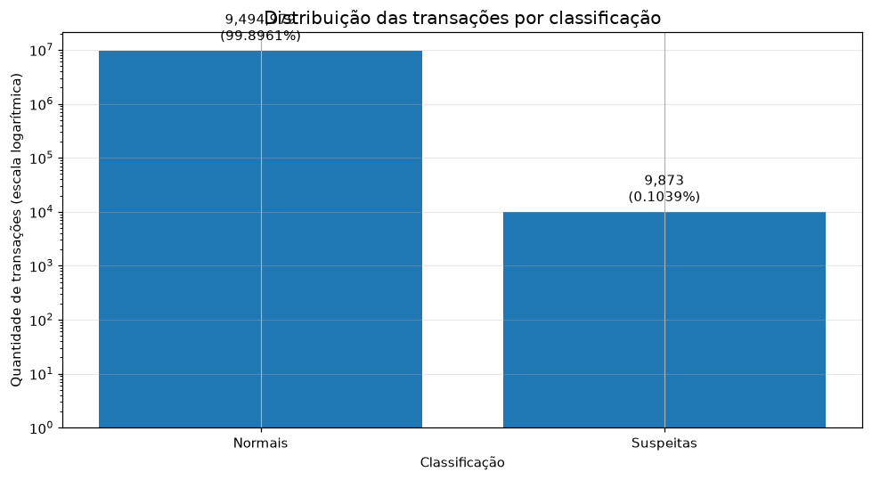

A cada 962 transações normais, existe aproximadamente uma transação suspeita

Isso afeta o treinamento e, principalmente, a interpretação das métricas. Por exemplo, um classificador que previsse todas as transações como a classe 0 teria acurácia de aproximadamente **99,896127**, mesmo não identificando nenhuma transação positiva.

Por isso, a acurácia sozinha não é suficiente. Na avaliação dos modelos, devemos utilizar outras métricas como:

- **Precisão (Precision):** entre as transações sinalizadas como positivas, qual proporção realmente pertence à classe positiva?
- **Revocação (Recall):** entre todas as transações positivas existentes, qual proporção foi identificada?
- **F1-score:** média harmônica entre precisão e recall.
- **PR-AUC:** área sob a curva Precisão-Recall, útil para avaliar o desempenho em diferentes limiares quando a classe positiva é rara.

A **análise exploratória** evidencia o porquê os analistas precisam avaliar a capacidade de identificar a classe minoritária, e não apenas a quantidade de acertos.

## 5.2 - Distribuição dos Valores das Transações - `Amount`

A coluna `Amount` representa o valor informado para cada transação.

### 5.2.1 - Estatísticas gerais

| Estatística   |     Resultado |
| -------------- | ------------: |
| Quantidade     |     9.504.852 |
| Média         |      8.762,97 |
| Mediana        |      6.113,72 |
| Desvio padrão |     25.614,95 |
| Mínimo        |          3,73 |
| Máximo        | 12.618.498,40 |

A média é superior à mediana e o desvio padrão é elevado em relação à média. Isso é compatível com uma distribuição assimétrica à direita: muitos valores estão concentrados em uma faixa inferior, enquanto uma quantidade menor de observações apresenta valores muito elevados.

### 5.2.2 - Comparação entre as classes

| Estatística | Classe 0 — Normal no rótulo | Classe 1 — Positiva no rótulo |
| ------------ | ----------------------------: | ------------------------------: |
| Quantidade   |                     9.494.979 |                           9.873 |
| Média       |                      8.729,88 |                       40.587,67 |
| Mediana      |                      6.114,63 |                        5.322,79 |
| Mínimo      |                          3,73 |                           15,82 |
| Máximo      |                    999.962,19 |                   12.618.498,40 |

A média das transações positivas é aproximadamente 4,65 vezes a média da classe negativa. Entretanto, a mediana das positivas é menor. Isso mostra que uma quantidade menor de valores extremamente elevados influencia fortemente a média da classe positiva.

### 5.2.3 - Percentis

O **percentil** é uma medida estatística que indica a posição de um valor em relação a um grupo ou a uma amostra dividida em 100 partes iguais.

| Percentil     |  Classe 0 |   Classe 1 |
| ------------- | --------: | ---------: |
| P25           |  2.142,93 |   2.723,79 |
| P50 (mediana) |  6.114,63 |   5.322,79 |
| P75           | 10.458,95 |   9.789,67 |
| P90           | 16.558,43 |  21.197,62 |
| P95           | 22.031,33 |  39.698,43 |
| P99           | 44.938,16 | 419.540,08 |

A diferença no P99 indica uma cauda superior muito mais elevada entre as transações positivas. Isso sugere que valores extremos podem contribuir para distinguir distribuições, mas não que todo valor elevado seja suspeito.

### 5.2.4 - Transformação logarítmica

O notebook cria `Amount_log` com:

```python
dataset["Amount_log"] = np.log1p(dataset["Amount"])
```

A função `log1p(x)` calcula `log(1 + x)`. Essa transformação comprime a escala dos valores e facilita a visualização de distribuições com cauda longa.

A transformação:

- não remove registros;
- não elimina valores extremos;
- não converte moedas;
- não garante, isoladamente, melhora no desempenho de um modelo.

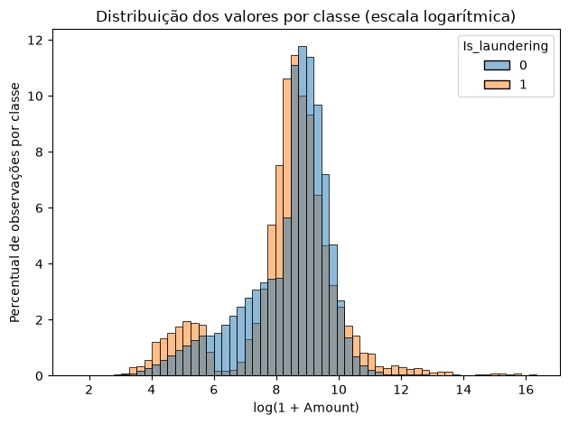

## 5.3 - Comparação de `Amount` por Moeda de Pagamento

Compara-se a distribuição de `Amount` entre as categorias de `Payment_currency`, separando as classes.

### 5.3.1 - Boxplots por Moeda

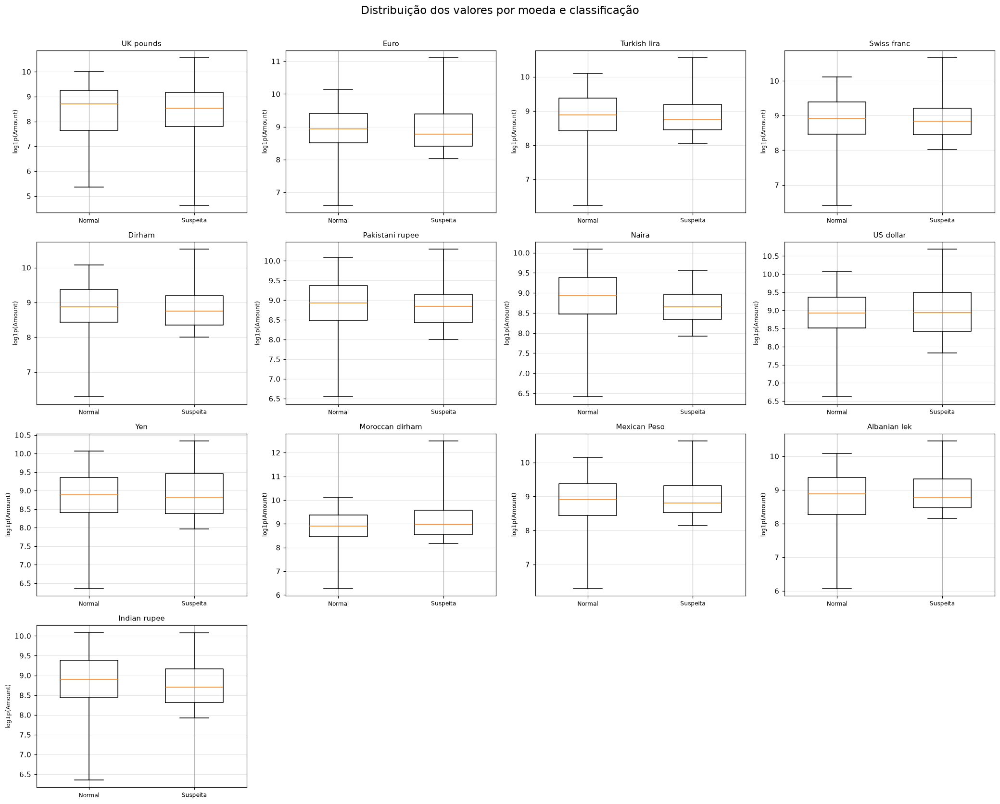

### 5.3.2 - Distribuição de Valores em UK Pounds

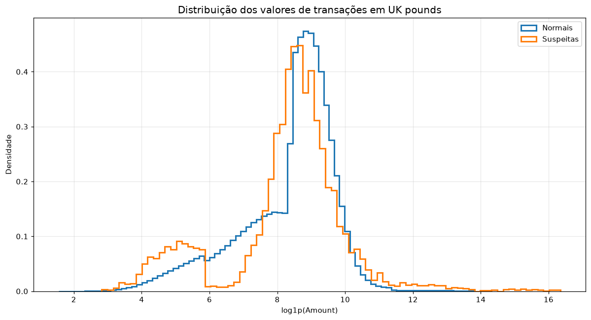

## 5.4 - Modalidades de Pagamento - `Payment_type`

| Modalidade      | Total de transações | Transações positivas | Taxa positiva |
| --------------- | --------------------: | ---------------------: | ------------: |
| Cash Deposit    |               225.206 |                  1.405 |     0,623873% |
| Cash Withdrawal |               300.477 |                  1.334 |     0,443961% |
| Cross-border    |               933.931 |                  2.628 |     0,281391% |
| ACH             |             2.008.807 |                  1.159 |     0,057696% |
| Credit card     |             2.012.909 |                  1.136 |     0,056436% |
| Debit card      |             2.012.103 |                  1.124 |     0,055862% |
| Cheque          |             2.011.419 |                  1.087 |     0,054041% |

* **Cross-border:** apresenta a maior quantidade absoluta de registros positivos.
* **Cash Deposit:** apresenta a maior taxa proporcional (0,623873%).
* **Cash Withdrawal:** apresenta a segunda maior taxa proporcional (0,443961%).

A quantidade indica quantas transações positivas existem em uma categoria. A taxa também considera o tamanho total da categoria.

A taxa é calculada pela média da variável binária `Is_laundering` em cada categoria, equivalente a:

$$
\text{Taxa positiva} = \frac{\text{Quantidade de positivos}}{\text{Total da categoria}} \times 100
$$

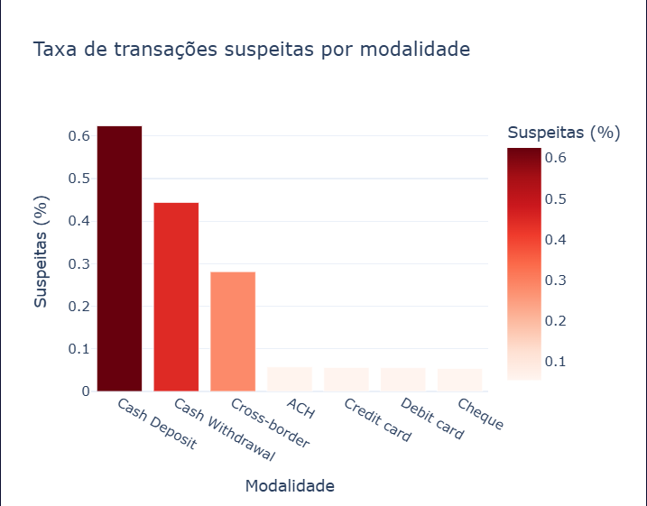


## 5.5 - Moedas

Foram identificadas 13 categorias de moedas em cada coluna:

* `Payment_currency`: moeda indicada para o pagamento.
* `Received_currency`: moeda indicada para o recebimento.

### 5.5.1 - Moeda de pagamento

| Moeda           |     Total | Positivas | Taxa positiva |
| --------------- | --------: | --------: | ------------: |
| Moroccan dirham |    25.395 |        90 |     0,354400% |
| Dirham          |    27.263 |        89 |     0,326450% |
| Swiss franc     |    27.492 |        82 |     0,298269% |
| Indian rupee    |    24.657 |        68 |     0,275784% |
| Mexican Peso    |    24.852 |        68 |     0,273620% |
| Turkish lira    |    27.996 |        73 |     0,260752% |
| Albanian lek    |    24.778 |        64 |     0,258294% |
| Yen             |    25.562 |        65 |     0,254284% |
| US dollar       |    26.061 |        60 |     0,230229% |
| Naira           |    27.143 |        62 |     0,228420% |
| Pakistani rupee |    27.196 |        62 |     0,227975% |
| Euro            |   117.164 |       260 |     0,221911% |
| UK pounds       | 9.099.293 |     8.830 |     0,097041% |

### 5.5.2 - Moeda recebida

| Moeda           |   Total   | Positivas | Taxa positiva |
| --------------- | :-------: | :-------: | :-----------: |
| Naira           |  45.046  |    288    |   0,639346%   |
| Moroccan dirham |  45.748  |    285    |   0,622978%   |
| Albanian lek    |  45.736  |    262    |   0,572853%   |
| Dirham          |  42.797  |    225    |   0,525738%   |
| Mexican Peso    |  45.255  |    235    |   0,519280%   |
| Turkish lira    |  42.545  |    218    |   0,512399%   |
| Pakistani rupee |  45.993  |    204    |   0,443546%   |
| Indian rupee    |  43.757  |    172    |   0,393080%   |
| Euro            |  231.911  |    716    |   0,308739%   |
| US dollar       |  43.664  |    118    |   0,270246%   |
| Swiss franc     |  42.931  |    113    |   0,263213%   |
| Yen             |  45.814  |    118    |   0,257563%   |
| UK pounds       | 8.783.655 |   6.919   |   0,078771%   |

As distribuições e taxas são diferentes entre moeda de pagamento e moeda recebida. A libra esterlina predomina em volume nas duas colunas, enquanto outras moedas apresentam taxas positivas proporcionais maiores.

Não realizada conversão dos valores monetários para uma moeda-base. Portanto, não se deve presumir que os valores de `Amount` possam ser comparados como se estivessem todos expressos na mesma unidade monetária.


### 5.5.3 - Taxa de Suspeitas por Moeda de Pagamento

| Moeda           | Total de transações | Suspeitas | Taxa de suspeitas |
| --------------- | --------------------- | --------- | ----------------- |
| UK pounds       | 9099293               | 8830      | 0.0970            |
| Euro            | 117164                | 260       | 0.2219            |
| Turkish lira    | 27996                 | 73        | 0.2608            |
| Swiss franc     | 27492                 | 82        | 0.2983            |
| Dirham          | 27263                 | 89        | 0.3264            |
| Pakistani rupee | 27196                 | 62        | 0.2280            |
| Naira           | 27143                 | 62        | 0.2284            |
| US dollar       | 26061                 | 60        | 0.2302            |
| Yen             | 25562                 | 65        | 0.2543            |
| Moroccan dirham | 25395                 | 90        | 0.3544            |
| Mexican Peso    | 24852                 | 68        | 0.2736            |
| Albanian lek    | 24778                 | 64        | 0.2583            |
| Indian rupee    | 24657                 | 68        | 0.2758            |

## 5.6 - Localização Bancárias

Foram identificadas 18 categorias em cada coluna:

* `Sender_bank_location`: moeda indicada para o pagamento.
* `Receiver_bank_location`: moeda indicada para o recebimento.

### 5.6.1 - Localização do remetente

| Localização |     Total | Positivas | Taxa positiva |
| ------------- | --------: | --------: | ------------: |
| Morocco       |    18.437 |        55 |     0,298313% |
| Mexico        |    17.662 |        44 |     0,249122% |
| Netherlands   |    16.770 |        41 |     0,244484% |
| India         |    17.596 |        42 |     0,238691% |
| Italy         |    18.895 |        45 |     0,238158% |
| Germany       |    19.259 |        43 |     0,223272% |
| Austria       |    18.050 |        38 |     0,210526% |
| Japan         |    18.468 |        38 |     0,205761% |
| Switzerland   |    20.503 |        41 |     0,199971% |
| USA           |    19.027 |        36 |     0,189205% |
| UAE           |    20.081 |        34 |     0,169314% |
| France        |    18.702 |        31 |     0,165758% |
| Albania       |    17.648 |        28 |     0,158658% |
| Spain         |    19.391 |        27 |     0,139240% |
| Turkey        |    20.902 |        27 |     0,129174% |
| Nigeria       |    20.027 |        25 |     0,124831% |
| Pakistan      |    20.346 |        25 |     0,122874% |
| UK            | 9.183.088 |     9.253 |     0,100761% |

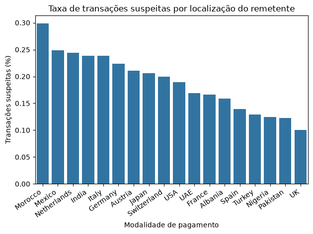

### 5.6.2 - Localização do destinatário

| Localização |     Total | Positivas | Taxa positiva |
| ------------- | --------: | --------: | ------------: |
| Nigeria       |    38.272 |       251 |     0,655832% |
| Morocco       |    38.704 |       253 |     0,653679% |
| Albania       |    38.783 |       235 |     0,605936% |
| UAE           |    35.897 |       195 |     0,543221% |
| Mexico        |    38.385 |       197 |     0,513221% |
| Turkey        |    35.586 |       177 |     0,497387% |
| Pakistan      |    38.980 |       169 |     0,433556% |
| Netherlands   |    37.314 |       148 |     0,396634% |
| Austria       |    38.844 |       154 |     0,396458% |
| India         |    36.936 |       137 |     0,370912% |
| Italy         |    36.517 |       131 |     0,358737% |
| Germany       |    38.540 |       102 |     0,264660% |
| USA           |    36.850 |        87 |     0,236092% |
| Spain         |    37.288 |        87 |     0,233319% |
| Japan         |    38.729 |        83 |     0,214310% |
| Switzerland   |    36.081 |        77 |     0,213409% |
| France        |    38.512 |        82 |     0,212921% |
| UK            | 8.864.634 |     7.308 |     0,082440% |

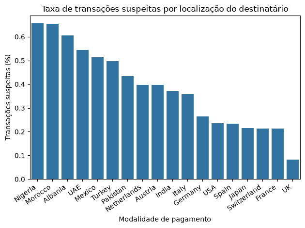/

O Reino Unido concrenta a maior parte do volume de transações em ambas as colunas. Entretanto, várias outras localizações apresentam taxas proporcionais positivas maiores.

### 5.6.3 - Mapa de Calor: Origem x Destino

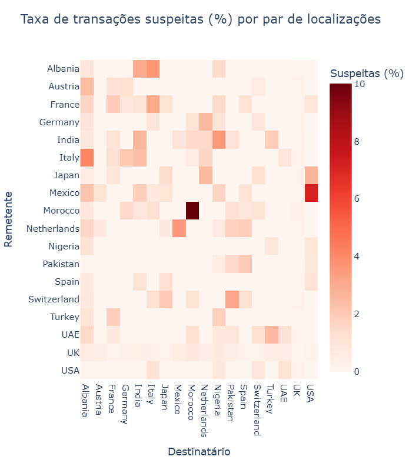

Cada célula representa a taxa percentual de transações positivas para uma combinação de localização do remetente e do destinatário. O gráfico de calor facilita a comparação das combinações, mas uma taxa elevada em uma célula não comprova, isoladamente, uma lavagem de dinheiro.

### 5.6.4 - Volume e Taxa Positiva por Localização Bancária

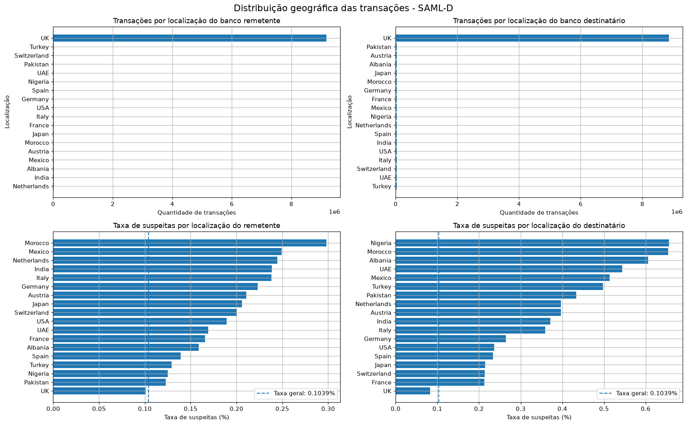

## 5.7 - Operações entre localizações iguais e diferentes

Comparação entre transações em que `Sender_bank_location` é igual a `Receiver_bank_location` e transações em que as localizações são diferentes:

| Relação entre as localizações | Total de transações | Positivas | Participação do volume | Taxa positiva |
| --------------------------------- | --------------------: | --------: | -----------------------: | ------------: |
| Mesma localização               |             8.570.504 |     6.828 |                 90,1698% |       0,0797% |
| Localizações diferentes         |               934.348 |     3.045 |                  9,8302% |       0,3259% |

A taxa positiva para operações entre **localizações diferentes** é aproximadamente **4,09 vezes** maior que a **taxa das operações na mesma localização**.

# 6. Comportamento das Contas e Relacionamentos

Nesta análise, as transações são agrupadas por conta remetente, conta destinatária e par remetente-destinatário. Aqui, procuramos identificar recorrência e volume de movimentações:

1. Comportamento das contas remetentes.
2. Comportamento das contas destinatárias.
3. Relacionamentos entre pares de contas.

## 6.1 - Contas Remetentes

Agrupamento utilizado:

```python
envios = (
    dataset.groupby("Sender_account")
      .agg(
          quantidade_envios=("Amount", "size"),
          valor_total_enviado=("Amount", "sum"),
          valor_medio_enviado=("Amount", "mean"),
          quantidade_destinatarios=("Receiver_account", "nunique")
      )
      .sort_values("quantidade_envios", ascending=False)
)
```

Os indicadores calculados são:

- `quantidade_envios`: quantidade de transações enviadas pela conta.
- `valor_total_enviado`: soma dos valores associados aos envios.
- `valor_medio_enviado`: média dos valores enviados.
- `quantidade_destinatarios`: quantidade de contas destinatárias distintas.

No resultado exibido, a **conta mais frequente** entre as primeiras 20 possui **754 envios**, **soma de 4.450.195,04**, **média de 5.902,12** e **25 destinatários distintos**.

## 6.2 - Contas destinatárias

```python
recebimentos = (
    dataset.groupby("Receiver_account")
    .agg(
        quantidade_recebimentos=("Amount", "size"),
        valor_total_recebido=("Amount", "sum"),
        valor_medio_recebido=("Amount", "mean"),
        quantidade_remetentes=("Sender_account", "nunique")
    )
    .sort_values("quantidade_recebimentos", ascending=False)
)

display(recebimentos.head(20))
```

O agrupamento de recebimentos calcula:

- `quantidade_recebimentos`: quantidade de transações recebidas;
- `valor_total_recebido`: soma dos valores recebidos;
- `valor_medio_recebido`: média dos valores recebidos;
- `quantidade_remetentes`: quantidade de contas remetentes distintas.

No resultado exibido, a conta mais frequente entre as primeiras 20 possui 751 recebimentos, soma de 4.182.791,24, média de 5.569,63 e 17 remetentes distintos.

## 6.3 - Pares de contas

O notebook também agrupa por `Sender_account` e `Receiver_account` simultaneamente:

```python
pares_contas = (
    dataset.groupby(["Sender_account", "Receiver_account"])
    .agg(
        quantidade_transacoes=("Amount", "size"),
        valor_total=("Amount", "sum"),
        valor_medio=("Amount", "mean")
    )
    .sort_values("quantidade_transacoes", ascending=False)
)
```

Os pares mais recorrentes exibidos apresentam até 84 transações entre a mesma origem e o mesmo destino.

## 6.4 - Fan-in e Fan-out

* **Fan-in:** várias contas de origem enviam valores para uma mesma conta de destino.
* **Fan-out:** uma conta de origem envia valores para várias contas de destino.

Esses padrões ajudam a explicar estrutura de movimentação entre contas e podem úteis na investigação de redes de transações. Contudo, uma conta apresentar muitos envios, recebimentos ou destinatários diferentes não é uma comprovação automática de lavagem de dinheiro.

**Limitação da análise atual:** os agrupamentos de contas e pares são ordenados por frequência, mas não cruzam diretamente esses agregados com `Is_laundering`. Logo, os primeiros colocados são os mais recorrentes, não necessariamente os mais suspeitos.

## 6.5 - Distribuição e Concentração das Movimentações por Conta

Cálculo da quantidade total de eventos associados a cada conta. Aqui, cada tarnsação gera um evento para a conta remetente e outro para a conta destinatária.

| Indicador           | Contas remetentes | Contas destinatárias | Movimentações totais |
| ------------------- | ----------------- | --------------------- | ---------------------- |
| Contas distintas    | 292715.00         | 652266.00             | 855460.00              |
| Média              | 32.47             | 14.57                 | 22.22                  |
| Mediana             | 12.00             | 13.00                 | 12.00                  |
| Percentil 90        | 14.00             | 18.00                 | 17.00                  |
| Percentil 95        | 233.00            | 21.00                 | 21.00                  |
| Percentil 99        | 506.00            | 191.00                | 522.00                 |
| Máximo             | 754.00            | 751.00                | 1498.00                |
| Contas com 1 evento | 27816.00          | 92413.00              | 48621.00               |

| Indicador                                        | Resultado |
| ------------------------------------------------ | --------: |
| Contas distintas que aparecem como remetente     |   292.715 |
| Contas distintas que aparecem como destinatária |   652.266 |
| Contas que aparecem nos dois papéis             |    89.521 |
| Contas distintas na união dos dois papéis      |   855.460 |

A distribuição é bastante assimétrica. A mediana é de 12 movimentações por conta no total, enquanto o máximo observado é 1.498. Ao separar os papéis, a mediana é 12 para remetentes e 13 para destinatários. Há uma cauda de contas com movimentação muito acima desses valores.

O notebook também mede concentração: o 1% de contas com mais movimentações (8.555 contas) reúne 30,23% dos eventos; os 5% (42.773 contas) reúnem 54,49%; e os 10% (85.546 contas) reúnem 58,73%. Isso demonstra concentração de atividade no conjunto, mas não indica automaticamente irregularidade.

Também se mede a concentração:

| Grupo de contas | Quantidade de contas | Eventos concentrados | Participação dos eventos (%) |
| --------------- | -------------------- | -------------------- | ------------------------------ |
| Top 1%          | 8555                 | 5746607              | 30.23%                         |
| Top 5%          | 42773                | 10359093             | 54.49%                         |
| Top 10%         | 85546                | 11164969             | 58.73%                         |

Isso demonstra concentração de atividade no conjunto, mas não indica automaticamente irregularidade.

## 6.6 - Visualização da Frequência por Conta

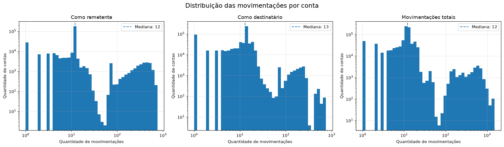

## 6.7 - Taxa de Contas Envolvidas em Operações Suspeitas

| Indicador                            | Quantidade |
| ------------------------------------ | ---------- |
| Contas remetentes                    | 4,950      |
| Contas destinatárias                | 4,074      |
| Total de contas distintas            | 7,902      |
| Participação sobre todas as contas | 0,92%      |

## 6.8 - Diversidade de Contrapartes e Recorrência dos Pares

Cálculo de quantas contrapartes distintas cada conta encontra:

| Indicador                              | Média | Mediana | P95 | P99 | Máximo |
| -------------------------------------- | -----: | ------: | --: | --: | ------: |
| Destinatários distintos por remetente |   3,03 |       1 |  22 |  45 |      60 |
| Remetentes distintos por destinatário |   1,36 |       1 |   1 |  17 |      50 |

Foram identificados **887.497 pares direcionados distintos** (remetente → destinatário). Desses, 781.631 aparecem em mais de uma transação. As transações que pertencem a pares repetidos somam 9.398.986, aproximadamente 98,89% do dataset. O par mais recorrente aparece em 84 transações.

Entre os registros positivos, o notebook identifica 7.758 pares direcionados distintos. Isso não significa que todos os pares repetidos sejam suspeitos: a repetição também pode representar relações recorrentes legítimas entre contas.

# 7. Tipologias - `Laundering_type`

Cálculo da taxa de transações positivas por tipologia:

| Tipologia            | Registros positivos |
| -------------------- | ------------------: |
| Structuring          |               1.870 |
| Cash_Withdrawal      |               1.334 |
| Smurfing             |                 932 |
| Deposit-Send         |                 945 |
| Layered_Fan_In       |                 656 |
| Layered_Fan_Out      |                 529 |
| Stacked Bipartite    |                 506 |
| Behavioural_Change_1 |                 394 |
| Bipartite            |                 383 |
| Cycle                |                 382 |
| Fan_In               |                 364 |
| Gather-Scatter       |                 354 |
| Scatter-Gather       |                 338 |
| Behavioural_Change_2 |                 345 |
| Single_large         |                 250 |
| Fan_Out              |                 237 |
| Over-Invoicing       |                  54 |

A tabela de contingência apresenta **17 categorias** (1) com registros exclusivamente **positivos** e 11 categorias iniciadas por `Normal_`(1) com registros exclusivamente negativos.


No resultado observado, a taxa é calculada 100% para as categorias positivas e 0% para as negativas. Isso representa um alerta de **Data Leakage** (vazamento de dados) para a tarefa de prever `Is_laundering`.

Se `Laundering_type` for fornecida como atributo de entrada, o modelo poderá receber uma informação que já revela a classe-alvo. Além disso, em uma aplicação de detecção, essa tipologia pode ser uma anotação produzida depois de uma investigação, e não uma informação disponível no momento da transação.

Portanto, essa coluna pode ser utilizada para **análise descritiva das categorias**, mas não deve ser incluída como atributo preditivo para classificação.

# 8. Análise Temporal

As colunas `Date`e `Time` representam a data e horário da transação e são agrupadas na coluna `hora_dia`, calculando:

* Volume total de transações;
* Quantidade de registros positivos;
* Taxa positiva por hora.

```Python
dataset["hora_dia"] = (
    dataset["Time"].astype(str).str.slice(0, 2).astype(int)
)
```

**Fuso horário:** a documentação técnica do SAML-D informa que os horários foram padronizados para UTC+00:00. Portanto, as horas e os dias apresentados abaixo devem ser interpretados nesse referencial, e não automaticamente como horário local do Brasil.

## 8.1 - Volume e Taxa por Hora

A hora é extraída do timestamp e as transações são agrupadas por faixa de 0 a 23 horas. Calcula-se o volume total, a quantidade de positivos e a taxa positiva em cada hora.

A hora **07:00 UTC** apresenta a maior taxa positiva registrada nessa agregação: aproximadamente **0,1558%**, com 222 transações positivas em 142.497 operações. O horário com maior volume de transações está na faixa diurna, com aproximadamente 540 mil operações em cada hora entre 08:00 e 17:00. Volume e taxa, portanto, não representam a mesma dimensão.

## 8.2 - Taxa por Dia da Semana

Agrupamos as transações por dia da semana. As taxas positivas observadas foram:

| Dia da semana | Taxa positiva |
| ------------- | ------------: |
| Sexta-feira   |       0,1083% |
| Quinta-feira  |       0,1077% |
| Segunda-feira |       0,1060% |
| Quarta-feira  |       0,1049% |
| Terça-feira  |       0,1040% |
| Sábado       |       0,0980% |
| Domingo       |       0,0980% |

As diferenças são pequenas em termos absolutos. Esses percentuais não demonstram que um dia seja inerentemente mais arriscado; descrevem apenas a frequência dos rótulos positivos no conjunto sintético e no fuso UTC usado pelo dataset.

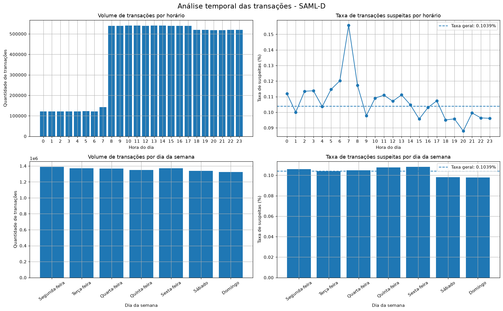

## 8.3 - Evolução Diária e Média Móvel

O período entre 07/10/2022 e 23/08/2023 contém **321 dias corridos**. O notebook apresenta, em média, cerca de 29.610 transações e 30,76 registros positivos por dia. A taxa positiva média diária informada é de aproximadamente 0,1040%.

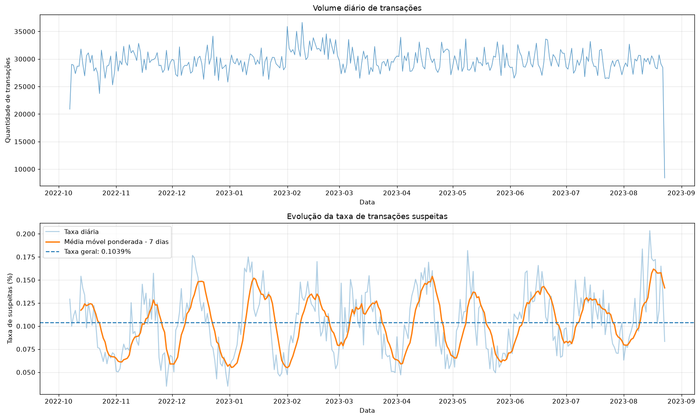

A taxa diária máxima observada foi de 0,2033%. Para suavizar oscilações entre dias, foi calculada uma taxa móvel de sete dias, ponderada pela soma dos positivos dividida pela soma das transações na janela. No período, essa taxa móvel variou aproximadamente de 0,0550% a 0,1618%.

## 8.4 - Comparação Mensal

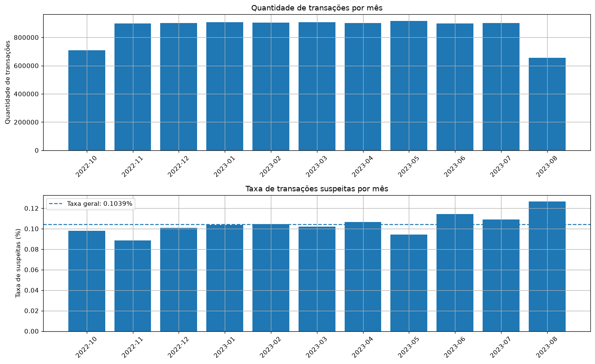

| Mês                  |      Transações |     Positivas |     Taxa positiva |
| --------------------- | ----------------: | ------------: | ----------------: |
| Outubro/2022          |           708.654 |           694 |           0,0979% |
| Novembro/2022         |           897.621 |           794 |           0,0885% |
| Dezembro/2022         |           900.341 |           907 |           0,1007% |
| Janeiro/2023          |           908.320 |           940 |           0,1035% |
| Fevereiro/2023        |           904.806 |           946 |           0,1046% |
| Março/2023           |           908.562 |           927 |           0,1020% |
| Abril/2023            |           902.883 |           962 |           0,1065% |
| Maio/2023             |           917.601 |           866 |           0,0944% |
| Junho/2023            |           897.243 |         1.024 |           0,1141% |
| Julho/2023            |           902.239 |           983 |           0,1090% |
| **Agosto/2023** | **656.582** | **830** | **0,1264%** |

## 8.5 - Limites da Interpretação Temporal

As agregações temporais ajudam a localizar períodos com diferentes volumes e proporções de rótulos positivos. Elas não substituem a análise de sequências e de comportamento por conta. Também não demonstram causalidade, sazonalidade recorrente ou uma regra operacional que possa ser aplicada diretamente a instituições financeiras reais.

# 9. Gráficos

### 9.1 - Distribuição de `Is_laundering`

Evidencia o desbalanceamento entre as classes.


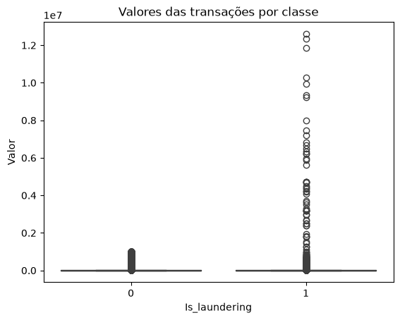

### 9.2 - Histogramas e Boxplots de `Amount` / `Amount_log`

Observa assimetria, dispersão e valores extremos.


### 9.3 - Quantidade por Tipo de Pagamento

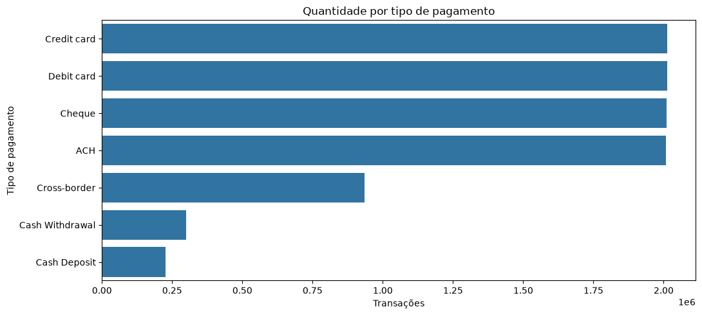

### 9.4 - Transações Suspeitas por Modalidade

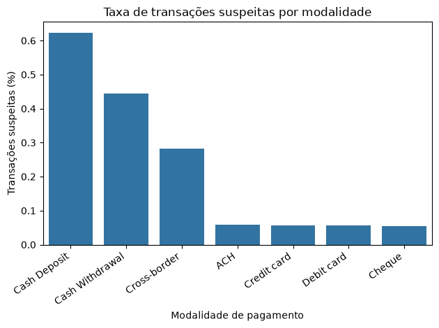

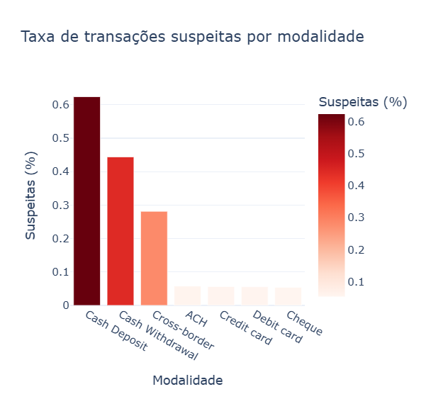

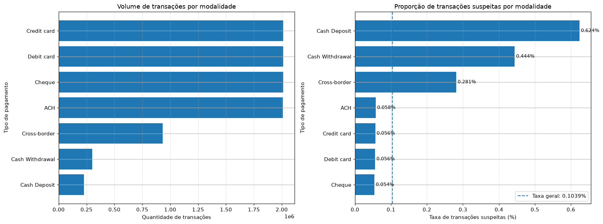

### 9.5 - Distribuição das Moedas no SAML-D

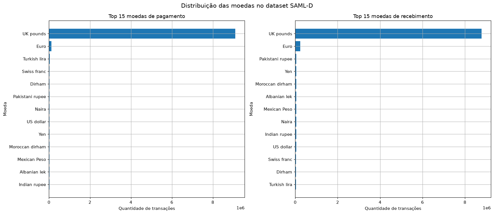

#### 9.5.1 - Distribuição dos Valores em UK Pounds


#### 9.5.2 - Boxplots por Moeda


### 9.6 - Transações Suspeitas por Moeda

Compara a frequência em `Payment_currency`e `Received_currency`.

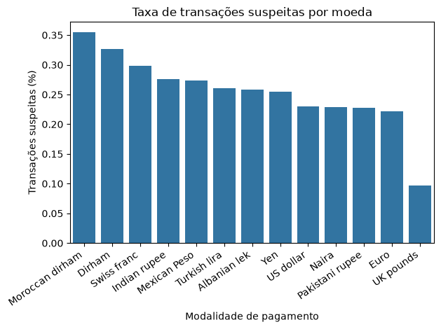

### 9.7 - Distribuição Geográfica das Transações


#### 9.7.1 - Transações Suspeitas por Localização do Destinatário


#### 9.7.2 - Transações Suspeitas por Localização do Destinatário


### 9.8 - Transações Suspeitas por Par de Localização

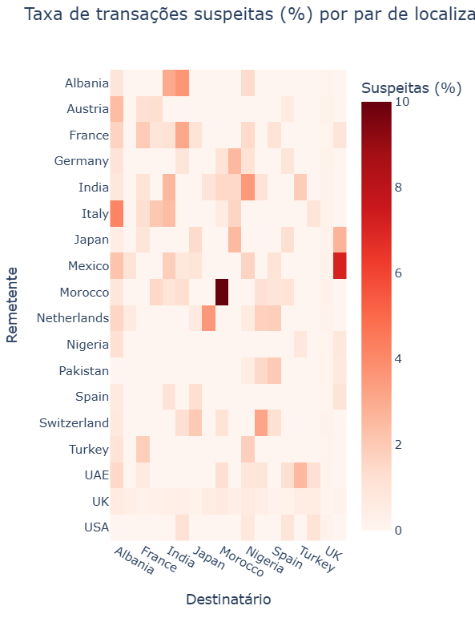

### 9.9 - Transações Suspeitas por Tipologia

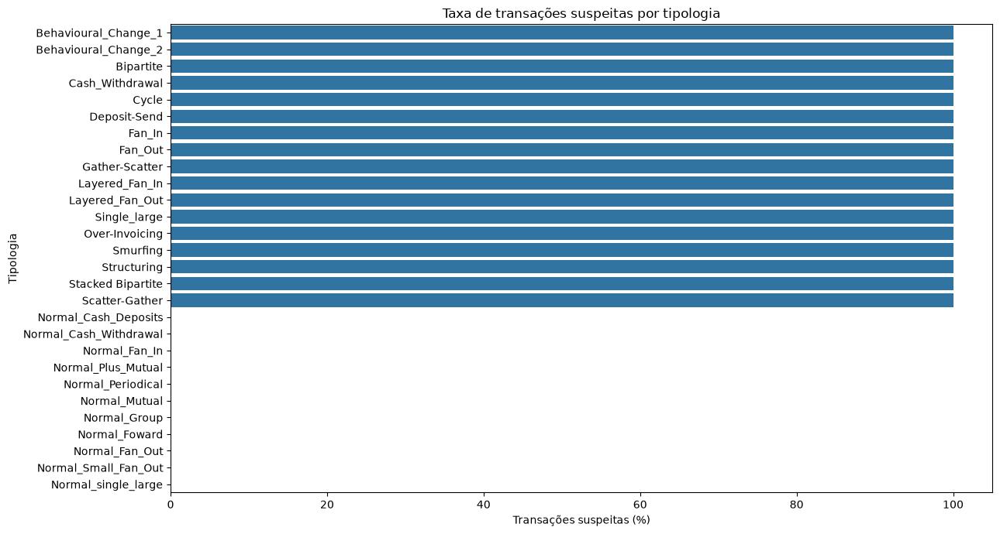

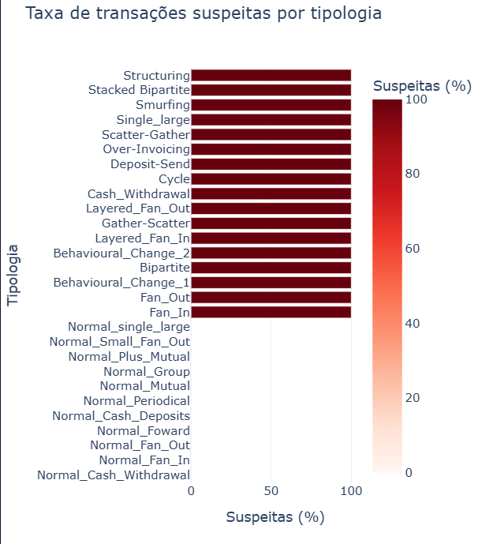

### 9.10 - Amount por Modalidade e Classe

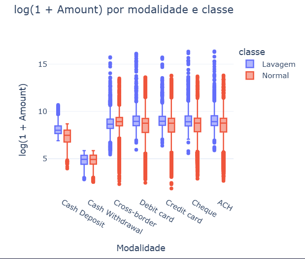

### 9.11 - Distribuição de log(1 + Amount) por Classe (% dentro da classe)

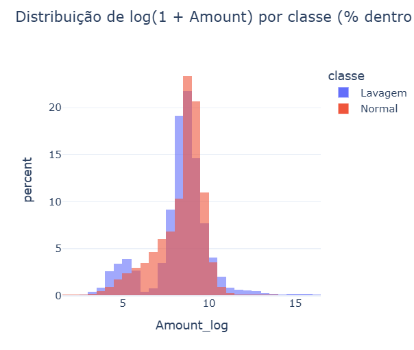

### 9.12 - Distribuição Global dos Valroes das Transações

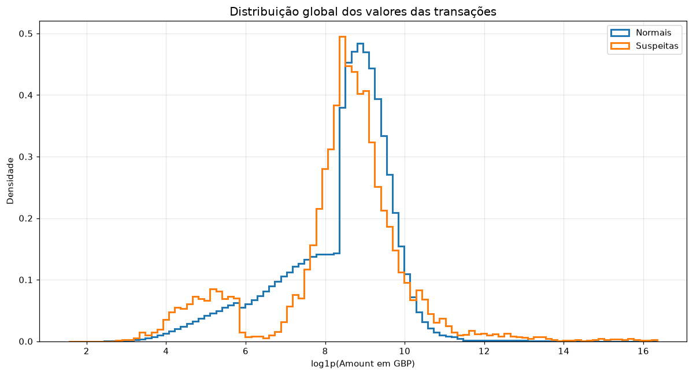

### 9.13 - Diversidade de Relacionamentos Financeiros

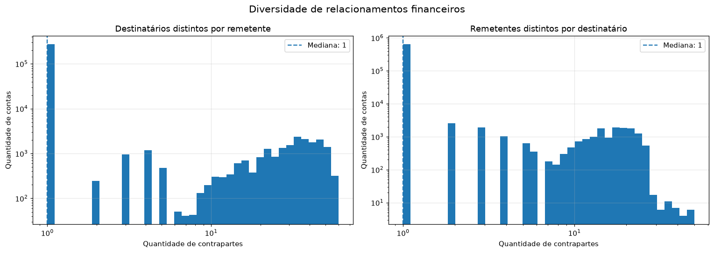

# 10 - Conclusão da Análise Exploratória

1. O dataset possui **9.504.852** **transações** e **12 colunas**, com período entre 07/10/2022 e 23/08/2023.
2. **Qualidade dos dados:** Não foram encontrados **valores ausnetes**, **duplicados**, **timestamps inválidos**, **IDs de conta negativos** ou **transferências da conta para ela mesma**.
3. A **variável-alvo** `Is_laundering` é extremamente **desbalanceada:** apenas 0,103873% dos registros são classificados como positivos (lavagem de dinheiro).
4. `Amount` apresenta amplitude elevada e assimetria à direita. A transformação `log1p`facilita a visualização da cauda longa.
5. A documentação do dataset padroniza `Amount` em GBP. Os campos de moeda descrevem atributos da operação e não indicam 13 unidades diferentes para `Amount`.
6. **Modalidade:**

   - **Cash Deposit** possui a **maior taxa positiva** dentro da **modalidade**.
   - **Cross-border** reúne a **maior quantidade e participação absoluta** no **total de registros positivos**.
7. As **moedas** e **localizações** apresentam diferentes distribuições entre **pagamento**, **recebimento**, **remetente** e **destinatário**.
8. No **SAML-D**, operações entre **localizações bancárias diferentes** apresentam **taxa positiva** aproximadamente **4,09 vezes** maior que **operações na mesma localização**.
9. A análise de contas revela **concentração de movimentações** e grande assimetria na quantidade de **contrapartes**. Frequência e repetição não comprovam suspeita.
10. **Análise temporal:**

    - Encontra variações por **hora**, **dia da semana**, **dia** e **mês**.
    - Os **timestamps** são tratados em UTC+00:00.
    - Os meses inicial e final são parciais.
11. `Laundering_type`: apresenta correspondência perfeita com o rótulo no conjunto analisado e representa risco de vazamento (**Data Leakage**) se utilizada como atributo preditivo de entrada.
12. Por ser sintético, o **SAML-D** permite desenvolver e comparar métodos, mas **não garante desempenho equivalente em dados bancários reais**.

# 11. Limitações e cuidados para a apresentação

- **Dados sintéticos:** os padrões refletem a construção do SAML-D e não necessariamente a distribuição do sistema bancário real.
- **Desbalanceamento:** a classe positiva é muito rara; métricas agregadas, especialmente acurácia, podem ser enganosas.
- **Moedas:** a documentação técnica define `Amount` como padronizada em GBP. Os notebooks não fazem uma conversão adicional; `Payment_currency` e `Received_currency` permanecem variáveis categóricas descritivas.
- **Localizações:** taxas por país não devem ser interpretadas como uma classificação real de risco geográfico.
- **Contas e redes:** alta recorrência, concentração ou diversidade de contrapartes não significa fraude. Os indicadores agregados não representam uma classificação independente de risco por conta.
- **Tipologias:** a correspondência perfeita de `Laundering_type` com `Is_laundering` impede seu uso ingênuo como entrada preditiva.
- **Temporalidade:** os gráficos por hora, dia da semana e mês descrevem o dataset observado; não comprovam sazonalidade recorrente nem substituem uma análise de sequências e intervalos entre transações.
- **Validação:** estatísticas calculadas sobre o dataset completo são descritivas. Decisões de modelagem e transformações devem respeitar a separação entre treino, validação e teste para evitar vazamento entre conjuntos.

# 12. Relação da EDA com o FraudRadar

A análise exploratória orienta o restante do projeto:

- o desbalanceamento justifica avaliar precisão, recall, F1-score e PR-AUC, em vez de depender da acurácia;
- as diferenças de escala e a distribuição de `Amount` motivam avaliar transformações e escalonamento quando adequados ao modelo;
- as variáveis categóricas precisam ser codificadas para modelos que não aceitam texto diretamente;
- a relação entre `Laundering_type` e `Is_laundering` alerta para a exclusão de uma variável que revelaria o alvo;
- a dimensão temporal do dataset sustenta a avaliação em períodos posteriores aos dados de treinamento, conforme a estratégia documentada no material de Machine Learning.

O notebook `FraudRadar_LightGBM` avança, depois da EDA, para uma representação temporal por eventos de conta e experimentos com janelas de sequência e LightGBM. Essa parte já pertence à etapa de engenharia de atributos e modelagem, não à EDA em sentido estrito. Os resultados de treinamento, validação, escolha de limiar, métricas de classificação, curvas de aprendizado e importância de atributos devem permanecer no relatório de Machine Learning, evitando misturar estatísticas descritivas do dataset com resultados de desempenho do modelo.

A EDA não escolhe automaticamente o melhor modelo. Ela fornece evidências para formular hipóteses, preparar os dados e selecionar estratégias de avaliação coerentes com o problema.
