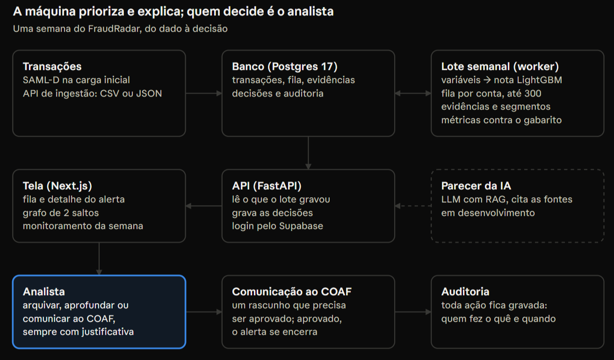

# **FRAUD RADAR PLD**

O sistema **Fraud Radar PLD** tem como objetivo identificar transações suspeitas de lavagem de dinheiro. A cada semana, verifica-se todas as transações e calcula uma nota de risco a cada conta, montando uma fila com as maiores suspeitas e seus motivos.

A ideia é auxiliar o analista de dados na identificação e análise de transações suspeitas em meio à uma quantidade de dados.

## Como funciona?

O diagrama mostra o funcionamento do sistema no período de uma semana:

* **Transações entram no banco de dados:** Para o projeto, elas vêm do SAML-D. Para aplicações reais, será analisadas transações vindas dos sistemas de bancos.
* **Cálculo do lote semanal:** Calcula-se as variáveis de cada transação, o modelo atribui uma nota, cria uma fila de suspeitas e guarda o motivo de cada alerta.
* **Visual (API -> Tela):** A **API** faz a conexão entre o banco de dados e a tela, mas não executa o modelo em si.
* **Decisão do analista:** O Fraud Radar PLD oferece muitas possibilidades ao analista: ele pode arquivar, aprofundar ou se comunicar ao **COAF** (Conselho de Controle de Atividades Financeiras), sempre com justificativa. Essa comunicação gera um rascunho que precisa ser aprovado na própria tela do alerta, e toda ação fica registrada.
* **Explicação por IA:** Um texto explicativo sobre cada alerta citando as leis e as normas relacionadas.

O sistema não roda o lote em tempo real, e sim, uma vez por semana. Na demonstração, o **modo** **replay** libera uma semana por vez. Tudo é executado no computador, em containers (**Docker Compose** ou **Terraform**).

## SAML-D: Dataset de Teste e Experimentação

Para o desenvolvimento do projeto, utilizamos o **SAML-D**, um conjunto de dados sintéticos (fictícios) e público com **Kaggle** com cerca de 9,5 milhões de transações bancárias, de outubro de 2022 a agosto de 2023.

Cada transação possui:

| Coluna                 | O que representa                         | O que estudar                                               |
| :--------------------- | :--------------------------------------- | :---------------------------------------------------------- |
| Time                   | Horário da transação                  | Conversão para horário e análise temporal                |
| Date                   | Data da transação                      | Datas, períodos e ordenação                              |
| Sender_account         | Conta remetente                          | Recorrência e comportamento de envio                       |
| Receiver_account       | Conta destinatária                      | Recorrência e comportamento de recebimento                 |
| Amount                 | Valor da transação                     | Distribuição, assimetria e valores extremos               |
| Payment_currency       | Moeda do pagamento                       | Variáveis categóricas                                     |
| Received_currency      | Moeda recebida                           | Conversões e diferenças de moeda                          |
| Sender_bank_location   | Localização bancária do remetente     | Comparações por localização                             |
| Receiver_bank_location | Localização bancária do destinatário | Operações entre localizações                            |
| Payment_type           | Tipo de pagamento                        | Frequências e padrões                                     |
| Is_laundering          | Indicador de lavagem de dinheiro         | Variável-alvo para classificação                         |
| Laundering_type        | Tipo de comportamento identificado       | Análise das categorias, com cuidado para não vazar o alvo |

O grande problema desse conjunto de dados é o seu **desbalanceamento extremo:** de 9,5 milhões de transações, apenas **9,873 registros** foram classificadas como **positivas de lavagem de dinheiro (0,1034%)**, divididas em 17 tipos.

#### Cuidados

* **Gabarito fica escondido do modelo:** O gabarito do período de treino ensina o modelo e o de teste apenas serve para pedir o acerto no final.
* **Correção do erro do gerador "CAIXA":** Num saque de espécie, o dinheiro sai da conta e não vai para outar conta. o SAML-D inventou uma conta falsa para esse outro lado nas transações normais, mas usou uma conta de verdade nas suspeitas. Só de olhar se o outro lado era falso, o modelo acertava 28% das lavagens. Agora, todo o saque e depósito em especíe tem o memso outro lado, o CAIXA, e essa pista sumiu.
* **Remoção dos atalhos do gerador:** O atalho serve como "cola": uma regra que no dado é sempre verdade, mas no mundo real não existe, como "*todo saque em espécie no exterior é lavagem*". Um programa, do nosso sistema, procurou essas regras, e no dado original elas entregavam 27% das lavagens. Depois das correções, sobraram apenas 2, ligadas a valores muito altos, que fazem sentindo no mundo real.
* **Separação do tempo:** O modelo aprende com o passado e é testado no futuro: treino de outubro de 2022 a abril de 2023, validação nas 4 semanas seguintes e testes nas 14 semanas finais.
* **Semana de segunda a domingo:** Realizamos testes para iniciar na sexta, o dia em que todos os dados se iniciam, e os números permaneceram iguais.

## Variáveis

O modelo realiza a leitura das **variáveis** das transações e **aprende quais combinações e padrões** **costumam ser lavagem de dinheiro**.

**Exemplo**

Uma das contas suspeitas conferidas enviou £31.851 por cartão de crédito. Algumas variáveis dessa transação:

* Foi a primeira transação entre essas duas contas;
* Quem envia tinha feito apenas 6 envios antes;
* Quem recebe estava 28 dias sem receber nada;
* Com essa transação, quem enviou repassou 79% do que havia recebido nos últimos 7 dias.

Juntas, elas apresentam uma combinação: uma conta com pouco histórico recebe dinheiro e, em poucos dias, repassa quase tudo para uma conta com que nunca tinha feito transação, e que estava parada. É um padrão típico de lavagem.

**Dois tipos de variável:** são 21 no modelo:

* **2 da própria transação:** o valor e o meio de pagamento.
* **19 do histórico das contas:** o que quem envia e quem recebe fizeram antes. Elas respondem por 92% da importância das variáveis no modelo.

Uma regra importante do modelo é utilizar apenas variáveis de transações passadas. Por exemplo, uma transação realizada numa terça às 10h, só entram transações de antes desse horário. Assim, o modelo nunca "*espia o futuro*", como na vida real, em que o futuro ainda não aconteceu.

| Nome na tela                                | Pergunta que ela responde                              |
| ------------------------------------------- | ------------------------------------------------------ |
| Primeira transação entre as duas contas   | Essas contas já tinham feito transação antes?       |
| Repasse do que quem envia recebeu em 7 dias | Quanto do que entrou na semana já está saindo?       |
| Origens novas de quem recebe em 7 dias      | De quantas contas novas o recebedor recebeu na semana? |
| Dias desde o último recebimento            | A conta estava parada e voltou de repente?             |
| Valor frente à média de quem envia        | Esse valor é muito maior que o normal dessa conta?    |

* **País, moeda e hora ficaram fora do modelo:** O gerador criou atalhos com elas, como "*todo depósito em espécie fora do horário comercial é lavagem*". Se tivessem sido mantidas, elas não teriam valor no mundo real e daria falsos alertas para clientes de certos países.
* **Meio de pagamento mantido:** "Depósito em espécie" ajuda o analista a entender o alerta.
* **Histórico do destinatário possui mais peso:** Sem as 7 variáveis do destinatário, o **PR-AUC** cai de 0,896% para 0,516%. Parte disso é sinal real de lavagem, outra pode ser um vício do erador, onde a conta normal costuma receber de apenas uma pessoa.

## Modelo: LightGBM

O **LightGBM** utiliza **algoritmos de Gradient Boosting** baseados em **Gradient Boosting Deciison Trees (GBDT)**. Também utiliza **árvores de decisão** para resolver **problemas de classificação**, **regressão** e outras tarefas de aprendizado supervisionado.

Uma árvore representa uma sequência de perguntas de sim ou não (ex: "*É a primeira transação entre essas contas?*"). O LightGBM constrói e combina centenas de árvores, buscando melhorar progressivamente as previsões, corrigindo os erros das anteriores. O resultado final é a combinação das respostas de todas as árvores.

#### Teste 1: Cinco Opções

Foram testadas cinco opções em um mesmo dado e medidas da mesma maneira:

| Opção                        | Em poucas palavras                                      | Lavadoras achadas numa fila de 300 contas por semana |
| ------------------------------ | ------------------------------------------------------- | ---------------------------------------------------- |
| Regras de cenário             | regras fixas, escritas à mão                          | 2,4%                                                 |
| Isolation Forest               | procura transações "estranhas", sem usar o gabarito   | 2,9%                                                 |
| Regressão logística          | modelo simples, que dá um peso a cada variável e soma | 80,9%                                                |
| GRU                            | rede neural que lê as transações da conta em ordem   | 96,3%                                                |
| **LightGBM (escolhido)** | **árvores de decisão em sequência**            | **96,5%**                                      |

* **LightGBM ou GRU?**
  * Os dois encontra quase as mesmas transações suspeitas.
  * No entanto, na fila do dia a dia, o GRU deixa 15,6 inocentes por semana, e o LightGBM apenas 2,2.
  * O LightGBM também explica cada alerta, treina sem placa de vídeo e foi 3,5 vezes mais rápido.
* A **Isolation Forest** quase não encontra lavagens. Isso mostra que, no SAML-D, a lavagem não aparenta ser "estranha", se parece com uma transação normal.
* **Como evitamos que o modelo decorasse?**
  * Com árvores grandes, o modelo decorava as poucas lavagens do treino.
  * Utilizamos árvores pequenas e paramos o treino quando o acerto na validação parou de melhorar, em 1,990 árvores.
* **Não testamos:** Apenas 0,1% das transações é lavagem, e não testamos dar mais peso a elas no treino (o "peso da classe"). É uma das perguntas para o professor.

#### Teste 2: Quatro Modelos

Foram testadas quatro modelos de classificação:

|       Modelo       |   Aplicação no sistema   | O que esperamos dele?                                                                                    |
| :----------------: | :-------------------------: | :------------------------------------------------------------------------------------------------------- |
|  DummyClassifier  |  Referência de desempenho  | Demonstrar o quanto um modelo que ignora as características consegue acertar.                           |
| LogisticRegression |   Classificação inicial   | Identificar relações lineares entre as características e a ocorrência de lavagem de dinheiro         |
|    RandomForest    | Identificação de padrões | Identificar combinações de características associadas a operações suspeitas                         |
|      LightGBM      |  Classificação avançada  | Aprender interações e padrões complexos, buscando melhorar a identificação de operações suspeitas |

* **Problema do Dummy Classifier:**

  * Apenas serve como referência para ver se os modelos complexos estão realmente aprendendo algo.
  * Ele não tenta aprender padrões que expliquem os motivos.
  * Apresentou aproximadamente 99,9% de acurácia, pois simplesmente classifica todas as transações como normais.
* **Logistic Regression:**

  * Identifica relações lineares entre as características e a ocorrência de lavagem de dinheiro.
  * Ela **consegue identificar grande parte de lavagens** (90,72% de recall), mas apresenta **muitos falsos positivos**. Isso acontece pela dificuldade do modelo de identificar relações complexas entre as características, classificando muitas transações normais como suspeitas.
  * Apesar do recall elevado, a **precisão** foi apenas de **1,03%** na validação.
  * Isso significa que praticamente todos os alertas gerados seriam **falsos positivos**, tornando o modelo pouco útil para investigar operações suspeitas.
* **Random Forest Classifier:**

  * Apresentou um equílibrio maior entre a **precisão (79,03%)** e a identificação de suspeitas. Entretanto, conseguiu encontrar apenas **48,58% das operações suspeitas (recall)**, deixando passar mais da metade dos casos reais.
* **LightGBM:**

  * Apresentou o melhor equilíbrio entre identificação de lavagens e quantidade de falsos positivos. Identificou **93,41% das operações suspeitas** na validação, superando os modelos anteriores.
  * Após ajustar o limiar de classificação, **alcançou 90,10% de precisão** **e 83,62% de recall** no teste.
  * Também obteve o melhor **PR-AUC (0,9167% na validação)**, tendo a maior capacidade de distinguir transações suspeitas em um cenário de classes extremamente desbalanceadas.
  * Também apresentou um tempo de treinamento menor que a Regressão Logística e o Random Forest.

### Comparação Entre as Versões de LightGBM

| Métrica                    | LightGBM 1                               | LightGBM 2                                           |
| --------------------------- | ---------------------------------------- | ---------------------------------------------------- |
| Representação dos dados   | 34 características agregadas por janela | 18 características por transação                  |
| Unidades de classificação | Janela de 10 transações                | Transação individual                               |
| Melhor AP na validação    | 0,171771                                 | 0,9167 (PR-AUC)                                      |
| AP no teste                 | Não executado                           | 0,9200 (PR-AUC)                                      |
| Iterações                 | 3,011 no modelo E                        | 317 no modelo C inicial                              |
| Tempo de treinamento        | 149,18 segundos                          | 6,27 segundos (modelo final da comparação inicial) |

#### Resultados da LightGBM 1

* 34 características agregadas.
* 1,078,404 registros de treinamento.
* 194,016 registros de validação.
* Ponderação da classe positiva (`scale_pos_weight`) de aproximadamente 192,26.
* Average Precision de 0,792881 no treinamento.
* Average Precision de 0,171771 na validação.
* 3,011 iterações.
* Aproximadamente 149 segundos de treinamento.

Na avaliação Top-K, o modelo apresentou: 

| Contas/janelas investigadas | Suspeitas encontradas | Precisão |
| :-------------------------: | :-------------------: | :-------: |
|             100             |          67          |    67%    |
|             300             |          109          |  36,33%  |
|            1,000            |          171          |  17,10%  |
|            3,000            |          229          |   7,63%   |

O modelo também passou por diversos experimentos, modificando parâmetros como regularização, quantidade de folhas, ponderação das classes e seleção de características. O melhor resultado de validação foi obtido com o LightGBM E, embora outros experimentos tenham apresentado resultados próximos.

#### Resultados da LightGBM 2

Seu desenvolvimento apresentou resultados bastante expressivos:

- PR-AUC de 0,9167 na validação.
- PR-AUC de 0,9200 no teste.
- Precisão de 90,10% no teste.
- Recall de 83,62% no teste.
- F1-score de 86,74% no teste.
- Acurácia de aproximadamente 99,97%.

O modelo também passou por experimentos de ajuste do limiar de classificação, chegando ao **threshold de 0,942**. Isso permitiu reduzir a quantidade de falsos positivos sem perder excessivamente a capacidade de identificar lavagens.

#### O que muda?

* **LightGBM 1:** classifica cada transação individualmente, utilizando características extraídas diretamente das operações.
* **LightGBM 2:** agrupa dez transações em cada janela e utiliza características agregadas para identificar comportamentos suspeitos.

Além disso, a proporção de exemplos positivos e a própria definição do que constitui uma amostra suspeita são diferentes.

Por isso, comparar diretamente um PR-AUC de 0,9200 com um AP de 0,171771 não seria metodologicamente correto. Os resultados indicam desempenhos dentro de suas respectivas abordagens, mas não permitem afirmar qual modelo é efetivamente superior.

Existe também uma diferença importante na generalização: a versão 2 apresentou resultados próximos entre validação e teste, enquanto a versão 1 apresentou uma diferença considerável entre treinamento (0,792881) e validação (0,171771). Isso sugere um possível sobreajuste, que merece investigação.

As duas versões do modelo conseguem aprender padrões relevantes de lavagem de dinheiro no SAML-D, mesmo diante o forte desbalanceamento das classes.

O primeiro modelo explorou uma abordagem temporal e comportamental, agrupando operações em janelas, enquanto o segundo apresentou resultados bastantes expressivos na classificação individual de transações.

## A Fila e a Explicação

A fila é de contas, porque o analista investiga clientes, não transações soltas. Cada conta aparece uma vez por semana, com a nota da sua transação mais suspeita.

* **Um corte em vez de 300 contas fixas:**

  * Com sempre 300 contas, sobravam sempre 76 inocentes por semana.
  * Agora só entram as contas com nota acima de um corte, escolhido na validação para pegar 95% das lavadoras.
  * A fila ficou com 223 contas por semana, em média, e só 2,2 inocentes. O limite de 300 ainda continua, porque é o que um analisa consegue revisar.
* **O motivo de cada alerta:**

  * O modelo mostra as 5 variáveis que mais empurraram a nota para cima, no quadro "Por que entrou na fila?" do alerta.
  * No exemplo da seção de variáveis, a que mais pesou foi "*Primeira transação entre as duas contas*".
* **Conferimos 10 alertas à mão:**

  * 8 lavadoras e 2 inocentes.
  * Nas lavadoras, o motivo fez sentido em 3 e fez sentido em parte em 5 (combinava com lavagem, mas não mostrava o padrão daquele tipo).
  * Os 2 inocentes eram saques pequenos em espécie, fáceis de arquivar.
* **A nota na tela vai de 0 a 100, mas não é chance.**

  * Uma nota 87 não quer dizer 87% de chance de lavagem: ela só serve para ordenar a fila.
  * A tela avisa isso quando se passa o mouse sobre "Nota de risco".
  * Se duas contas têm a mesma nota, quem desempata é a posição na fila.
* **O tipo de lavagem não vem do modelo:** O LightGBM só ordena; o tipo virá do parecer da IA, que ainda está em desenvolvimento.

## Segmentos (K-Means)

O K-Means separa as contas em grupos de comportamento parecido, sem usar o gabarito. Utilizamos esses grupos para ver se algum tipo de cliente recebe alarme falso demais:

* **Como funciona?**
  * Cada conta vira 8 números sobre as 12 semanas anteriores: quanto envia e recebe, valores médios, com quantas contas mexe e quanto é em espécie ou internacional.
  * O K-Means começa com alguns pontos de partida, põe cada conta
* **Quantos grupos?**
  * Testamos 3 a 8 grupos e escolhemos a opção de maior silhueta, uma nota de -1 a 1 que mede se cada conta está bem mais perto do seu grupo do que dos outros.
  * 8 grupos ganharam, com 0,677.
* **O que mostrou?**
  * Em 7 dos 8 grupos, o alarme falso é quase zero.
  * A exceção é o grupo que utilizou muito dinheiro em espécie, com alarme falso 16 vezes maior que o dos outros. É um viés que precisa ser acompanhado.
* **Ponto fraco da escolha:**
  * 8 é o máximo da faixa testada, e com a semana começando na sexta, a mesma regra escolhia 3.
* O grupo não muda a nota do LightGBM, apenas serve como lente para o monitoramento. Hoje o grupo fica gravado no banco de dados, mas a tela ainda não o mostra, ficando de fora da nota.

## Resultados

Nas 14 semanas de teste, a fila encontrou 95 a cada 100 contas suspeitas, e 99 a cada 100 contas na fila que realmente eram lavagem de dinheiro.

| Número                            | O que quer dizer?                                                                                                      |                 Resultado                 |
| ---------------------------------- | ---------------------------------------------------------------------------------------------------------------------- | :---------------------------------------: |
| Recall da fila                     | De cada 100 contas lavadoras da semana, quantas entraram na fila?                                                      |                   95,1%                   |
| Precisão da fila                  | De cada 100 contas na fila, quantas eram lavadoras?                                                                    |                   99,0%                   |
| Inocentes por semana               | Contas inocentes que o analista teria de olhar                                                                         |                    2,2                    |
| PR-AUC                             | Nota de 0 a 1 de quão bem o modelo põe as lavagens no topo da lista; ao acaso daria 0,001                            |                   0,896                   |
| Recall com 0,13% de falso positivo | Quantas lavagens o modelo pega quando só deixa passar 0,13% das transações normais; é a medida do artigo do SAML-D | 89,7% (a meta do plano era passar de 79%) |
| Recall em contas novas             | O mesmo, só nas lavagens de contas que nunca tinham lavado antes                                                      |                   96,0%                   |

Para comparar: as regras fixas, no mesmo dado, quase não acham nada (veja a tabela do modelo). Essa é a comparação mais honesta do projeto. E o lote semanal, rodando no banco de dados, chega exatamente aos mesmos números.

Na tela, a visão geral mostra o recall da fila semana a semana, com a meta de 95%. Numa semana sem gabarito, como uma enviada pela ingestão, o recall aparece como "—", e não como 0%.

## A Precisão de 99% não é overfit?

Não. O Overfit é quando o modelo decora o treino, o sinal de overfit é ir bem no treino e mal no teste. O underfit ir mal nos dois. Nenhum deles acontece aqui:

e
