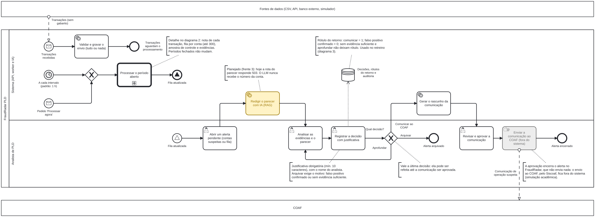
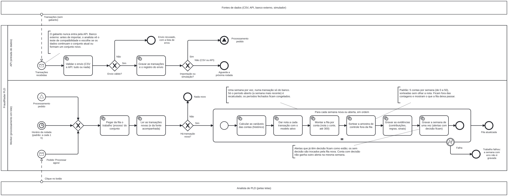
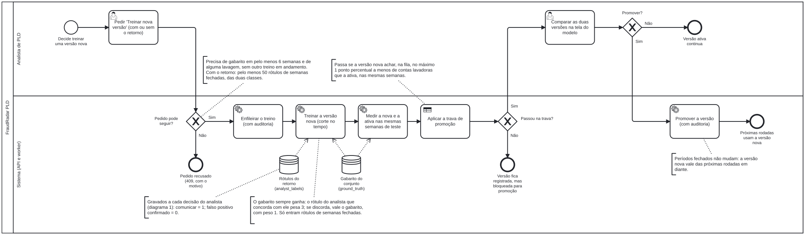

# BPMN do processo

Três diagramas BPMN 2.0 do processo de negócio do FraudRadar, desenhados a partir do código da
`main` em 16/11/2026 (depois do PR #17, retorno dos analistas). Quando o desenho e o código
divergirem, vale o código: atualize o diagrama no mesmo PR que muda o fluxo.

| Diagrama | O que mostra |
|---|---|
| [1. Monitoramento PLD](01-aml-monitoring.bpmn) | Ponta a ponta: transações chegam, o sistema monta a fila, o analista decide e a comunicação ao COAF é aprovada |
| [2. Entrada de dados e processamento do período](02-period-processing.bpmn) | Detalhe da entrada de transações e da atividade "Processar o período aberto" do diagrama 1 |
| [3. Retreino e promoção do modelo](03-model-retraining.bpmn) | Como o retorno dos analistas vira versão nova do modelo, e a trava que impede promover uma versão pior |

## Abrir e editar

Os `.bpmn` são a fonte. Abra em <https://demo.bpmn.io> (arraste o arquivo para a página) ou no
Camunda Modeler. O `.svg` (para este README) e o `.png` (para os slides) são exportações: depois de
editar o `.bpmn`, exporte os dois de novo.

## Legenda

| Símbolo | Significado |
|---|---|
| Tarefa com ícone de pessoa | feita pelo analista nas telas |
| Tarefa com engrenagem | feita pelo sistema (API, worker ou IA) |
| Tarefa com mão | feita por uma pessoa fora do sistema |
| Tarefa com tabela | regra de negócio aplicada pelo sistema |
| Borda grossa com `+` | o detalhe está em outro diagrama |
| Caixa grande com `≡` embaixo | repete em ordem, uma vez para cada item (aqui, cada semana) |
| Círculo com envelope | começa quando chega uma mensagem |
| Círculo com relógio | começa num horário |
| Círculo com triângulo | sinal: o fim de um fluxo dispara o começo de outro com o mesmo nome |
| Círculo na borda, com raio | erro durante a atividade da borda |
| Cilindro | dados gravados no banco |
| Losango com X | o caminho segue por uma das saídas |
| Linha tracejada com seta | mensagem entre participantes |
| Texto com colchete | anotação |
| Tarefa **amarela** | planejada, ainda não existe |
| Tarefa **cinza** | fora do sistema |

## 1. Monitoramento PLD

- As transações chegam sem gabarito e esperam o processamento. Ele roda no intervalo configurado
  (60 minutos por padrão) ou quando o analista pede "Processar agora".
- O sistema atualiza a fila da semana aberta, e o analista abre um alerta pendente. O parecer da IA
  está **planejado**: hoje a rota responde 503, à espera da frente 3.
- O analista registra a decisão com justificativa (pelo menos 10 caracteres), e o nome dele fica
  gravado. Arquivar exige o motivo: falso positivo confirmado ou sem evidência suficiente.
  Aprofundar volta para a análise.
- Comunicar gera o rascunho, que o analista revisa e aprova. A aprovação encerra o alerta. O envio
  ao COAF fica fora do sistema: o FraudRadar é uma simulação acadêmica e não envia nada.
- A decisão pode ser refeita até a comunicação ser aprovada; vale a última. Cada decisão grava o
  rótulo do retorno dos analistas (usado no diagrama 3) e a auditoria.

## 2. Entrada de dados e processamento do período

- CSV e API: todas as linhas são validadas, e uma linha com erro recusa o envio inteiro. O gabarito
  nunca entra pela API. O envio fica esperando a próxima rodada.
- Importação de banco externo e simulador: ao terminar, pedem um processamento.
- O worker pega da fila o trabalho `process` do conjunto, lê as transações novas e, se houver,
  processa cada semana nova ou aberta, uma por vez e numa transação só do banco: variáveis da conta,
  nota de cada transação, fila por conta (nota de pelo menos o corte, até 300 contas), amostra de
  controle e evidências.
- Só o período aberto é recalculado; os fechados ficam congelados. Alertas com decisão ficam como
  estão; os sem decisão são trocados pela fila nova.
- Se uma semana falha, nada dela é gravado e o trabalho fica como falho.

## 3. Retreino e promoção do modelo

- O analista pede uma versão nova, com ou sem o retorno dos analistas. O pedido só segue com
  gabarito em pelo menos 6 semanas, alguma lavagem e nenhum treino em andamento. Com o retorno,
  também precisa de pelo menos 50 rótulos de semanas fechadas, das duas classes.
- No treino, o gabarito sempre ganha. O rótulo do analista que concorda com ele pesa 3; quando
  discorda, vale o gabarito, com peso 1.
- A versão nova e a ativa são medidas nas mesmas semanas de teste. A trava de promoção bloqueia a
  versão que acha, na fila, mais de 1 ponto percentual a menos de contas lavadoras que a ativa.
- Promover é decisão do analista e fica na auditoria. Só as próximas rodadas usam a versão nova;
  os períodos fechados não mudam.

## De onde vem cada regra

| Regra | Código ou documento |
|---|---|
| Decisão, justificativa, motivo do arquivamento, rascunho e aprovação | `api/repositories/decisions.py`, `api/schemas/alerts.py` |
| Rótulo que cada decisão deixa | `src/fraudradar/model/feedback.py`, `docs/analyst-feedback.md` |
| Validação do envio (tudo ou nada, sem gabarito) | `src/fraudradar/data/ingestion.py`, README (seção Ingestão) |
| Processamento contínuo, período aberto, conjuntos e banco externo | `docs/external-data.md` |
| O que cada semana grava, fila e amostra de controle | README (seção Worker), `worker/batch.py`, `worker/queue.py` |
| Quando o retreino pode rodar | `src/fraudradar/model/eligibility.py`, `src/fraudradar/model/feedback.py` |
| Trava de promoção | `api/repositories/models.py`, `src/fraudradar/model/training.py` |
| Parecer da IA (planejado) | `api/routes/ai.py` |
