# DER do FraudRadar

Diagramas entidade-relacionamento do banco. Eles foram gerados a partir do DDL versionado em
`db/init/002_tables.sql` a `005_connections.sql`, na `main` de 16/11/2026.

Cada diagrama tem três arquivos:

- `.mmd`: a fonte editável, em Mermaid. O GitHub desenha esse arquivo direto na tela.
- `.svg` e `.png`: exportações (o PNG em 2x, para slides).

| Diagrama | O que mostra |
|---|---|
| [01-overview](01-overview.png) | as 19 tabelas e como elas se ligam, sem as colunas |
| [02-transactions-model](02-transactions-model.png) | transações, contas, envios pela API, gabarito, versões do modelo, notas e lotes semanais |
| [03-alerts-decisions](03-alerts-decisions.png) | alerta, evidências, parecer, decisão, comunicação ao COAF e rótulo do analista |
| [04-platform](04-platform.png) | tabelas globais (`public`): conjuntos de dados, processamento, trabalhos e conexões externas; também a base do RAG e a auditoria |

## Como ler

- **Cardinalidade (pé de galinha):** `||` é exatamente um, `|o` é zero ou um e `o{` é zero ou
  muitos.
- **Tipo de linha:** a linha cheia é um relacionamento identificador, em que a chave estrangeira
  faz parte da chave primária do filho (ex.: `ground_truth.transaction_id`). A linha tracejada é
  um relacionamento não identificador.
- **"(sem FK)" no rótulo:** a coluna aponta para a outra tabela, mas o banco não tem a constraint
  (ver a tabela abaixo). Na coluna, "sem constraint" quer dizer o mesmo.
- **Chaves:** PK é chave primária, FK é chave estrangeira e UK é única. "único com X" quer dizer
  que a coluna é única junto com X.
- **Valores aceitos:** quando há um `CHECK ... IN (...)`, a coluna de comentário traz a lista.
- **Cores:**
  - vermelho: `ground_truth`, o gabarito do SAML-D, que o modelo nunca lê;
  - verde: `analyst_labels`, o retorno dos analistas, que nunca se mistura com o gabarito
    ([analyst-feedback.md](../analyst-feedback.md)).

## Dois níveis de schema

- **Por conjunto de dados:** as 15 tabelas de domínio (de `transactions` a `audit_log`) existem
  uma vez em cada conjunto. O SAML-D usa `public`, e cada base externa ganha um schema próprio,
  registrado em `datasets.schema_name`. A API escolhe o schema pelo cabeçalho `X-Dataset`, com
  `SET LOCAL search_path` ([external-data.md](../external-data.md)).
- **Globais:** `datasets`, `processing_settings`, `jobs` e `external_connections` ficam sempre em
  `public` (`003` a `005`).

## Vínculos sem constraint

| Coluna | Aponta para | Por quê |
|---|---|---|
| `transactions.sender` e `receiver` | `accounts.account` | `accounts` é derivada de `transactions`, e a FK deixaria lenta a carga das ~9,5 milhões de linhas |
| `transactions.ingestion_id` | `ingestions.id` | o gatilho da FK rodaria a cada linha do `COPY`; a API grava os dois juntos |
| `alerts.week` | `weekly_batches.week` | o DDL não declara a FK |
| `datasets.active_model_version` | `model_versions.version` do schema do conjunto | `datasets` fica em `public`, e as versões ficam no schema de cada conjunto: uma FK não aponta para um schema escolhido em tempo de execução |
| `audit_log.entity` e `entity_id` | qualquer tabela | registro genérico: o nome da tabela e o id em texto |

## O que o esquema garante

- **`alerts`:**
  - uma linha por conta e semana (`UNIQUE (account, week)`);
  - `week` é sempre uma segunda-feira (`CHECK`, também em `weekly_batches` e `analyst_labels`);
  - o status `in_review` existe no `CHECK`, mas nem a API nem o worker o gravam.
- **`model_versions`:** no máximo uma versão ativa por conjunto (índice único parcial
  `WHERE active`).
- **`decisions`:** o `archive_reason` só aparece quando a decisão é `archive`, e só como
  `false_positive` ou `insufficient_evidence`.
- **`reports`:** uma comunicação aprovada exige `approved_by` e `approved_at`.
- **`processing_settings`:** um gatilho cria a configuração de todo conjunto novo. Por isso a
  ligação com `datasets` é exatamente um para um.
- **`rag_documents`:** o vetor tem 384 dimensões (multilingual-e5-small), com índice HNSW de
  cosseno, e `(source, chunk_index)` é único.
- **`external_connections`:** a senha só existe cifrada (`password_encrypted`, Fernet).

## Bancos antigos

`db/upgrades/006_analyst_feedback.sql` e `007_i18n.sql` levam um banco já criado ao mesmo
esquema. O DER mostra o resultado, que é igual ao do `db/init`.

## Como editar

Edite o `.mmd` no GitHub ou em <https://mermaid.live> e exporte de novo o `.svg` e o `.png`. Os
diagramas vieram do `db/init`; se o DDL mudar, eles precisam mudar junto.
