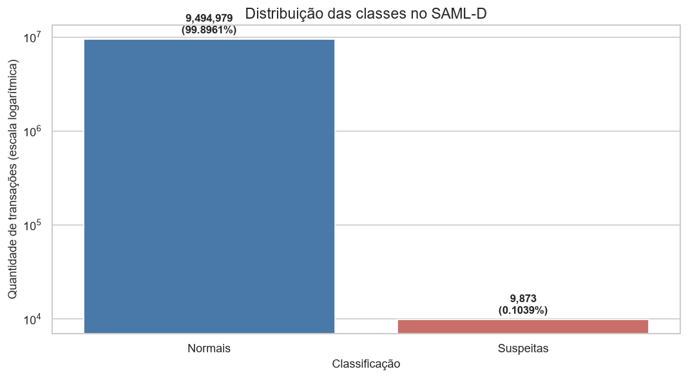
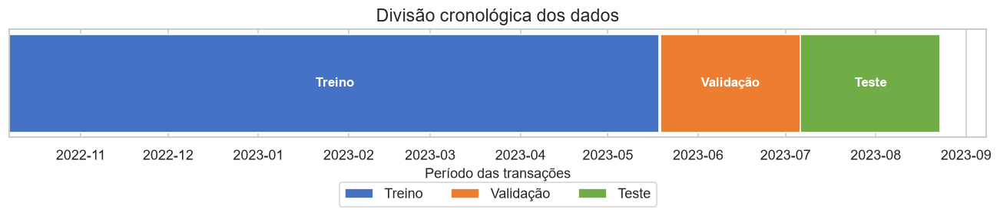
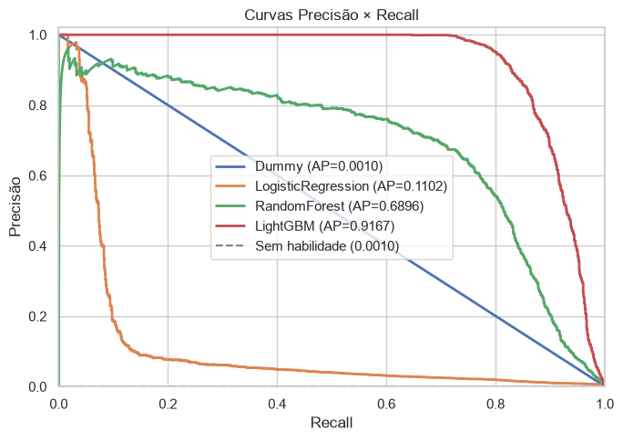
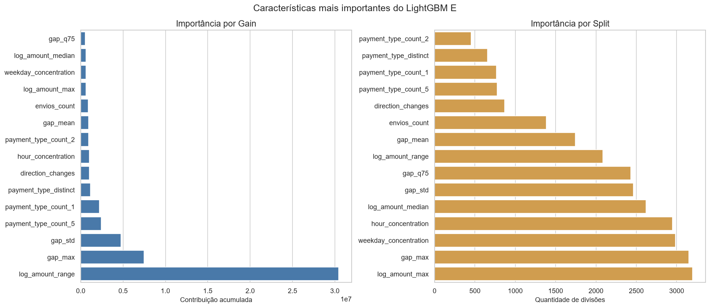

# Gráficos Finais da LightGBM

### 1. Desbalanceamento das Classes (Slide 7)

Apresentar o **desbalanceamento extremo** **do dataset SAML-D: de 9,5 milhões de transações, apenas 9,873 são lavagens de dinheiro**. Mostra que a acurácia isoladamente não é uma métrica adequada (acurácia de 99%).

"*Antes de treinarmos os modelos, nós fizemos uma análise inicial dos dados e encontramos um problema muito importante: o desbalanceamento extremo do dataset, onde apenas cerca de 0,1% das operações representavam lavagem de dinheiro.*

*Isso significa que um modelo poderia acabar classificando todas as transações como normais e retornar uma acurácia elevad de 99% por ser a classe majoritária. Foi justamente o que aconteceu com o modelo DummyClassifier.* 

*Por isso, aprendemos que não podemos avaliar esse tipo de problema apenas com a acurácia. Também precisamos considerar outras métricas para avaliar como a precisão, recall e PR-AUC, que mostram melhor a capacidade de identificar os casos suspeitos*."

### 2. Divisão Temporal dos Dados (Slide 7)

Demonstrar que o **treinamento** seguiu a **ordem cronológica das transações**.

"*Outro cuidado foi respeitar a ordem em que as transações aconteceram. Em vez de misturar operações de diferentes datas, utilizamos os dados mais antigos para treinar o modelo e períodos posteriores para validar e testar seu desempenho. Dessa forma, evitamos que o modelo utilize informações do futuro para tentar prever algo que aconteceu no passado.*"

### 3. Comparação dos Modelos (Slide 8 + Extra)

**Experimento 1 - Yuji**

* **Dummy Classifier:** O modelo apresentou 99% de acurácia, classificando todas as transações como normais por ser a classe majoritária.
* **Logistic Regression:** Identificou boa parte das lavagens (90,72% de recall), mas apresentou muitos **falsos positivos (1,03% de precisão)**.
* **Random Forest Classifier:** Apresentou um equílibrio maior entre a **precisão (79,03%)** e a identificação de suspeitas. Entretanto, mas encontrou apenas **48,58% das operações suspeitas (recall)**, deixando passar mais da metade dos casos reais.
* **LightGBM:** Foi o modelo com melhor desempenho, encontrando **93,41% das operações suspeitas**, alcançou **90,10% de precisão** e **83,62% de recall**. Conseguiu equilibrar a identificação de lavagens e a quantidade de falsos alertas.

"*Durante o desenvolvimento, também realizei experimentos com diferentes modelos para entender quais abordagens poderiam funcionar melhor nesse problema.*

*Comecei com o DummyClassifier, que serviu como referência, depois testei a Regressão Logística, o Random Forest e o LightGBM.*

*Os resultados mostraram limitações diferentes: a Regressão Logística conseguiu encontrar muitos casos suspeitos, mas gerou muitos falsos alertas. Já o Random Forest apresentou uma precisão maior, mas deixou passar mais da metade dos casos positivos.*

*O LightGBM apresentou o melhor equilíbrio nessa comparação. Na validação, chegou a 93,41% de recall. Depois, com o ajuste do limiar de classificação, alcançou 90,10% de precisão e 83,62% de recall no teste.*"

“*Esses foram os experimentos que realizei para entender melhor o comportamento dos modelos de classificação. Paralelamente, o Vinicius também desenvolveu seus próprios testes, explorando outras abordagens e pensando na aplicação desses modelos dentro do nosso sistema.*”

**Experimento 2 - Vinicius**

| Opção                        | Em poucas palavras                                      | Lavadoras achadas numa fila de 300 contas por semana |
| ------------------------------ | ------------------------------------------------------- | ---------------------------------------------------- |
| Regras de cenário             | regras fixas, escritas à mão                          | 2,4%                                                 |
| Isolation Forest               | procura transações "estranhas", sem usar o gabarito   | 2,9%                                                 |
| Regressão logística          | modelo simples, que dá um peso a cada variável e soma | 80,9%                                                |
| GRU                            | rede neural que lê as transações da conta em ordem   | 96,3%                                                |
| **LightGBM (escolhido)** | **árvores de decisão em sequência**            | **96,5%**                                      |

"*Além desses experimentos, o Vinicius também realizou uma comparação entre diferentes abordagens, incluindo regras de cenário, Isolation Forest, Regressão Logística, GRU e LightGBM.*

*Nesse caso, a avaliação considerou quantas contas suspeitas cada abordagem conseguiria encontrar em uma fila de 300 contas por semana. O LightGBM conseguiu encontrar 96,5%, ficando muito próximo da GRU, que chegou a 96,3%.*

*A escolha do LightGBM também levou em consideração outros fatores, como a quantidade de falsos alertas, o tempo de treinamento e a possibilidade de explicar os motivos de cada alerta*."

### 4. Importância das Características (Slides 9)

Demonstra quais características foram mais importantes para as decisões da LightGBM e permite demonstrar como ele identificou os padrões.

"*Além de avaliar os resultados, também analisamos quais características foram mais importantes para o modelo. Isso nos ajuda a entender quais informações tiveram maior influência nas decisões e quais padrões ele aprendeu a identificar.*

*É importante lembrar que uma característica ter grande importância para o modelo não significa necessariamente que ela seja a causa de uma operação suspeita.*"

